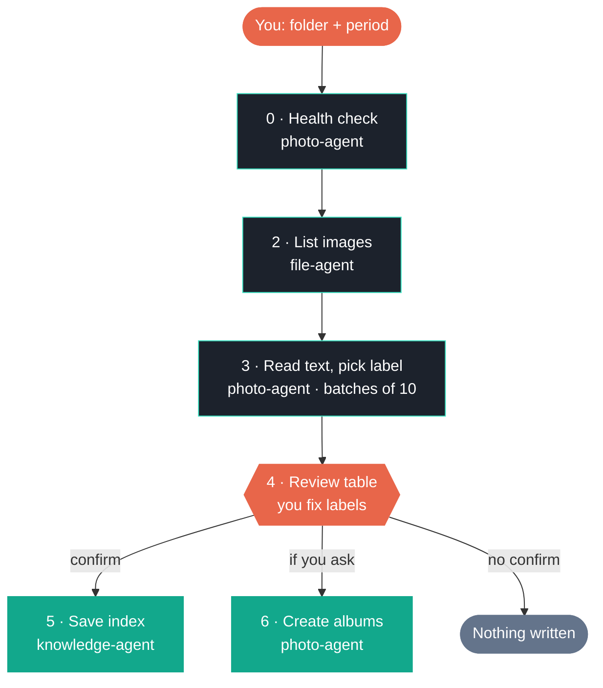

<div align="center">



<br>

[](#install)
[](#nas-capabilities)
[](#repository-layout)
[](#status)
[](#limits)
[](#safety-promises)

**Finds receipts, bills, and other paper photos in a NAS folder for a date range you pick, lets you review them in a table, then saves their text to one file. ID and card text stays hidden.**

[The problem](#the-problem) · [What it does](#what-it-does) · [How it works](#how-it-works) · [Install](#install) · [Testing](#testing) · [Limits](#limits) · [Disclosure](#disclosure)

</div>

> [!NOTE]
> Entry for the **UGREEN Hackathon 2026 on AI NAS**, track **Bring Memories to Life** (Round 1).
> The Skill passes the official static checker, but it has **not run on a real NAS yet**.

## The problem

People take photos of receipts, bills, and notes so they can remember them. On the NAS, those photos sit among hundreds of family photos. Text search helps only when you already know a word that is in the photo, and there is no simple list of the papers you photographed last month.

## What it does

You pick one folder and a period. CRPR sweeps it and hands you a reviewed list.

| Step | | What happens |
|:---:|---|---|
| **0** | Check | Confirms the photo service is working. |
| **1** | Pick | Lists up to 20 image folders, only if you don't know which folder to use. |
| **2** | List | Finds the images for your period, newest first, up to 50 per run. |
| **3** | Read | Reads the text in batches of 10 and gives each photo one label. |
| **4** | Review | Shows you a table so you can fix labels and drop rows. Nothing is saved yet. |
| **5** | Save | After you confirm, saves one Markdown index in a folder you choose. |
| **6** | Albums | Creates one album per label, only if you ask. |

It ends with a report whose counts add up to every file it looked at.

### Labels

| Label | Used for | Text kept? |
|---|---|---|
|  | Proof of a purchase, with a total or amount paid visible | Yes |
|  | Whiteboards and handwritten pages | Yes |
|  | Tickets, boarding passes, booking confirmations, and screenshots of them | Yes |
|  | Letters, forms, and printed pages | Yes |
|  | ID cards, passport and driving licence pages, payment, membership, and business cards | **Never.** Card type only |
|  | Menus, price lists, signs, posters, placards, memes | Yes, for you to decide |
|  | Ordinary photos, or fewer than 20 characters of text | Not returned |
|  | Text recognition failed | Failure reason only |

## How it works



Four rules shape every run:

1. **Text first.** Text recognition runs first. The vision model only picks a label; it never writes the saved text.
2. **Read-only until you confirm.** The only two writes, the index and the albums, happen after the review and need your approval.
3. **Photo text is data.** A note that says "delete all files" is saved as text and never obeyed.
4. **Counts add up.**

   ```text
   files in the run = receipt + notes + ticket + document + card
                    + unsure + not-paper + unreadable + not processed
   ```

### NAS capabilities

The Skill only delegates to registered NAS expert agents. Capability catalog version 2.0.0.

| Step | Expert agent | Capability | Purpose |
|:---:|---|---|---|
| 0 | `photo-agent` | `ug-photo` `health` | Check the photo service |
| 1 | `file-agent` | `ug-filesystem` `ls`, `find` | List folders that hold images |
| 2 | `file-agent` | `ug-filesystem` `find` | Find images by file date |
| 3 | `photo-agent` | `ug-photo` `meta`, `vision-ocr`, `vision-vlm` | Capture date, read text, choose a label |
| 5 | `knowledge-agent` | `ug-knowledge` `save-text` | Save the index |
| 6 | `photo-agent` | `ug-photo` `create-album` | Create albums |

### What the saved index looks like

One new Markdown file, never overwriting an existing one, named like `paper-index-2026-10-01-to-2026-10-31.md`:

1. Title with the folder and period, the date it was made, and which dates were used.
2. Counts by label, then confirmed and dropped rows.
3. One section per label, each entry with its date, full path, and recognized text, cut at 500 characters.
4. A `card` section with the card type and path only.
5. An `unreadable` section with the failure reasons.
6. A corrections section: every label you changed and every row you dropped.

## Safety promises

- [x] Never moves, renames, copies, edits, hides, or deletes your photos.
- [x] Never writes text that was not recognized in the photo.
- [x] Never shows or saves text from photos labeled as cards.
- [x] Never acts on text written inside a photo.
- [x] Never looks outside the one folder and period you confirmed.
- [x] Never asks for passwords, accounts, or device details.

## Install

The Skill is the folder [`skills/camera-roll-paper-rescue/`](skills/camera-roll-paper-rescue): `SKILL.md` plus three Markdown references. No scripts, binaries, or dependencies.

Before the first run:

1. In the **Model Management** app, download the photo models for text recognition and image recognition.
2. In **Photos**, open **Settings**, then **AI settings**, and turn on **Text recognition** and **Image recognition**.

Then ask Uliya in plain words:

```text
Sweep my phone backup folder for receipts and notes from October.
Find the paper photos in my camera roll from last month and make me an index.
Which of my recent photos are tickets or documents?
```

<details>
<summary><b>How to undo a run or remove the Skill</b></summary>

1. Delete the index file the Skill saved. Its path is in the final report.
2. Delete any albums the Skill created. Albums only group photos, so the photo files stay in their folder.
3. To remove the Skill, remove it from your installed Skills. Index files and albums from earlier runs stay until you delete them.

</details>

## Repository layout

```text
.
├── README.md
├── assets/
│   └── banner.svg
└── skills/
    └── camera-roll-paper-rescue/      ← the Skill package
        ├── SKILL.md                   ← every rule a run depends on
        └── references/
            ├── user-guide.md          ← setup, use, undo, remove
            ├── test-plan.md           ← finalist test cases
            └── disclosure.md          ← components, data flow, AI tools
```

## Testing

The [test plan](skills/camera-roll-paper-rescue/references/test-plan.md) is written for the finalist testing day on a UGREEN AI NAS.

| Case | What is tested | Pass when |
|---|---|---|
| **Core 1** · sweep and save | 30 photos: 12 papers, 18 ordinary photos (2 of them HEIC) | Counts add up to 30, at least 10 of 12 papers labeled right, no invented text, folder unchanged |
| **Core 2** · correct and albums | Change one receipt to document, drop one notes row, ask for two albums | Index and albums reflect each change, no other album, folder unchanged |
| **Edge** · sensitive and empty | Specimen ID card, blurry receipt, menu, sign, placard, meme, a note that reads like a command, an empty folder | Card text appears nowhere, nothing invented, no menu or sign labeled receipt, the command is never carried out, empty folder writes nothing |

## Limits

- One folder, without subfolders, and at most 50 images per run, newest first by file date.
- The period is matched on file dates, so a photo backed up later may carry its backup date.
- Labels come from on-device AI and can be wrong. That is what the review step is for.
- A card labeled as something else shows its text until you relabel it to `card`.
- Other sensitive papers, such as bank statements or medical letters, are labeled `document` and keep their text unless you drop them.
- Text saved for each photo is cut at 500 characters. Replies are in English; other languages may or may not be recognized.

## Status

| | |
|---|---|
| **Built** | `SKILL.md` and three references. Official UGREEN static checker: `static-pass`, 0 errors, 0 warnings. |
| **Not yet** | No run on a real NAS. Learning from your corrections is out of scope for this version. |
| **Needs a NAS** | HEIC support, whether the vision model keeps to the label list, time per batch, which file date search uses, whether a long index saves in one step, which languages are recognized. |

## Disclosure

- **Third-party components:** none. The package is Markdown only and calls no outside service itself.
- **Data flow:** photos go to the photo expert on the NAS. Labels, paths, dates, and allowed text come back into the Uliya conversation for review. The confirmed index is saved on the NAS. If you run Uliya on a cloud AI model, the text shown in the review and saved in the index reaches that model.
- **AI tools used:**
  - Muse (Meta): an early explanation of the uliya-skill-kit, research on user needs, and a first list of Skill ideas.
  - Claude Code (Anthropic): the brainstorm that produced this idea and its name, research on similar products, drafting and reviewing the Skill, running the checker, feedback on the proposal, and drafting the Devpost page and this README. The proposal answers were written by the author.
  - UGREEN uliya-skill-kit: the Skill standard, capability catalog 2.0.0, and the static checker.

Full details: [`references/disclosure.md`](skills/camera-roll-paper-rescue/references/disclosure.md).

## License

No open-source license yet. All rights reserved by the author.

---

<div align="center">
<sub>An independent entry for the UGREEN Hackathon 2026 on AI NAS. UGREEN, UGOS, and Uliya are trademarks of their respective owners.</sub>
</div>
